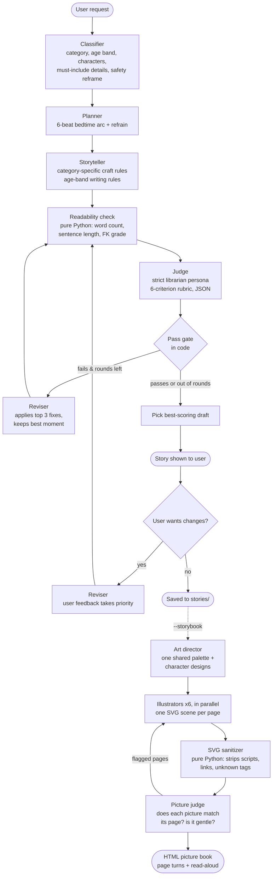

# Bedtime Story Generator with an LLM Judge

Hippocratic AI coding assignment. Takes any bedtime story request and produces a story suited to ages 5 to 10, then
has a separate LLM judge review it and drive revisions until it meets a quality bar.

> **Model:** Per the recruiter's instructions, this uses Anthropic's **Claude Haiku 5.5** (`claude-haiku-5-5`)
> in place of GPT-3.5 Turbo. The model is set in one place: `llm.py`.

## Quick start

```bash
pip install -r requirements.txt
cp .env.example .env          # then put your ANTHROPIC_API_KEY in .env
python main.py                # type any request
python main.py --example      # use the built-in Alice and Bob request
python main.py --age 8-10 --rounds 3
python main.py --example --storybook   # also makes an illustrated, read-aloud picture book
```

After the story is printed, you can type changes ("make it funnier", "add a dragon") and the story is rewritten and
re-judged. Press Enter to finish, and the final story is saved to `stories/`.

| Flag | Meaning |
|---|---|
| `--age {5-7,8-10}` | Listener's age band. Inferred from the request if omitted. |
| `--rounds N` | Maximum judge-driven revision rounds (default 2). |
| `--quiet` | Hide progress messages and judge scorecards. |
| `--example` | Skip the prompt and use the example request. |
| `--storybook` | Turn the final story into an illustrated HTML picture book with a "Read to me" button, and open it. |

## System design



### The components

**1. Classifier**. Turns a free-form request into a structured brief: one of seven categories
(adventure, friendship, animal, fantasy, funny, calming, learning), an age band, the characters, and a list of
`must_include` details pulled from the request. It also does the **safety reframe**: rather than refusing an
unsuitable request, it rewrites it into a gentle version that keeps the spirit (for example, "a dragon that eats a
village" becomes "a hungry dragon who learns to cook soup with the villagers"), and records what changed.

**2. Planner**. Designs a six-beat arc built for bedtime: cozy opening, spark, try and stumble,
turning point, resolution, and **wind-down**. Most story arcs end at the resolution; a bedtime story needs an extra
beat that lowers the energy. The planner also invents a short **refrain** that repeats so a child can say it along,
which is a classic read-aloud technique.

**3. Storyteller**. Writes from the outline using two layers of guidance: age-band rules
(length, sentence length, vocabulary) and **category-specific craft rules** (a funny story needs escalation and a
running gag; a calming story needs slow pacing and little conflict).

**4. Readability check** (pure Python, no LLM). Computes word count, average sentence length and Flesch-Kincaid grade.
LLMs are unreliable at judging their own reading level or counting words, so these objective numbers are given to
the judge as evidence, and the pass gate enforces the grade ceiling directly.

**5. Judge**. A deliberately different persona from the storyteller: a strict children's librarian
who "did not write this story" and rarely gives 10s, to counter self-grading leniency. It scores six criteria
(age appropriateness, story arc, engagement, language level, request fidelity, bedtime fit), writes its critique
*before* scoring so the scores follow from the reasoning, names the story's best moment, and gives up to three
concrete, actionable fixes.

**6. Pass gate** (in code). The judge provides scores; Python decides. A story passes only if age appropriateness
is at least 9, every other criterion is at least 7, the average is at least 8, and the reading level is within the
target. Keeping the threshold in code makes the bar consistent and stops a malformed judge reply from passing a story.

**7. Reviser.** Applies the judge's top fixes while explicitly preserving the "best moment," so revisions don't
sand off what was working. The loop is capped (default two rounds), and the system returns the **highest-scoring**
draft rather than the last one, because revisions can occasionally make a story worse.

**8. User feedback loop.** The same reviser handles the user's requested changes, but with the user's wishes taking
priority over the original plan. The new version then goes back through the judge, so user edits still get a
safety and quality check.

**9. Storybook (optional, `--storybook`).** Turns the approved story into a picture book you open in a browser.
- An **art director** call first fixes one palette and a simple shape-based design for each character. Because all
  illustrators receive the same art direction, pages drawn in parallel still look like one book.
- **Illustrators** (one per page, run in parallel with a thread pool) draw each scene as SVG, so no separate image
  model is needed and the project stays on the required model.
- An **SVG sanitizer** in plain Python parses every drawing and removes anything that isn't a basic shape (scripts,
  event handlers, external links). Unparseable drawings are retried once, then replaced with a calm night-sky
  fallback so the book is never missing a page.
- A **picture judge** compares each illustrator's scene description with its page text and flags pictures that show
  the wrong moment or anything frightening; flagged pages are redrawn with the judge's note.
- The book uses Andika, a typeface designed for beginning readers, and a **Read to me** button built on the
  browser's speech synthesis. It reads page by page, turns pages by itself, and slows down near the end so the
  story winds down like a real bedtime reading.

## Design decisions worth calling out

- **Separate agents with narrow jobs.** One huge prompt tends to drop instructions. Splitting understanding,
  planning, writing and judging means each prompt is short and each step can be inspected and tuned on its own.
- **Structured JSON between steps.** The classifier, planner and judge return JSON, so data flows between steps
  reliably. `llm.call_model_json` tolerates code fences and retries once if parsing fails.
- **Behaviour set by persona, not temperature.** Claude Haiku 5.5 doesn't accept a `temperature` setting, so each
  agent's style (a strict, consistent judge vs. an imaginative storyteller) comes from its system prompt.
- **Prompts separated from logic.** All prompts live in `prompts.py`, so the control flow in `pipeline.py` stays
  readable.

## Project layout

```
main.py         CLI: input, feedback loop, saving
pipeline.py     Orchestration: classify, plan, write, judge, revise
prompts.py      All prompts, category guides and age-band rules
readability.py  Deterministic reading-level metrics
storybook.py    Optional illustrated, read-aloud HTML picture book
llm.py          Anthropic API wrapper (model choice lives here)
```

## Sample run

<!-- Replace this with real output from your own run before submitting. -->
```
$ python main.py --example
```

